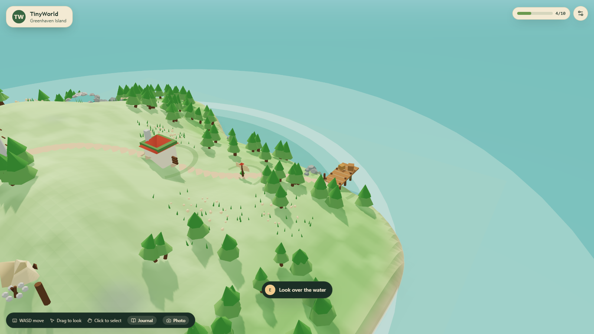
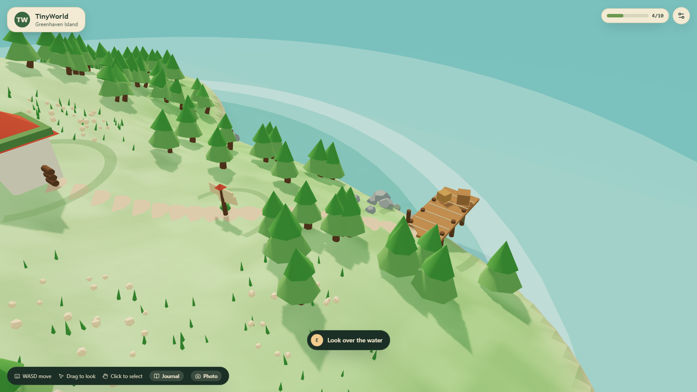
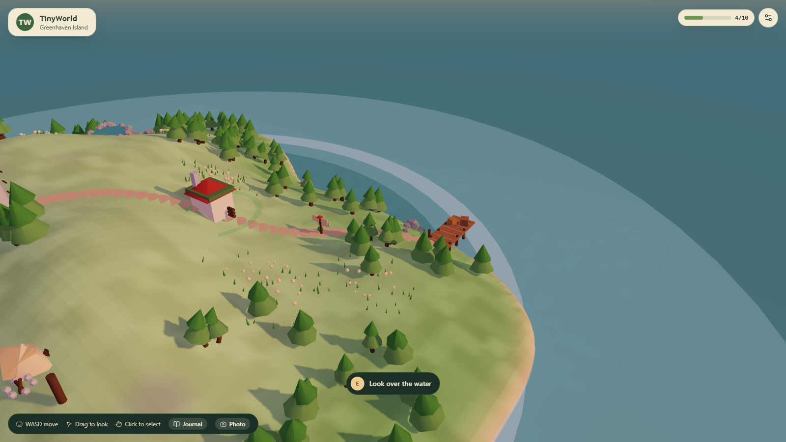
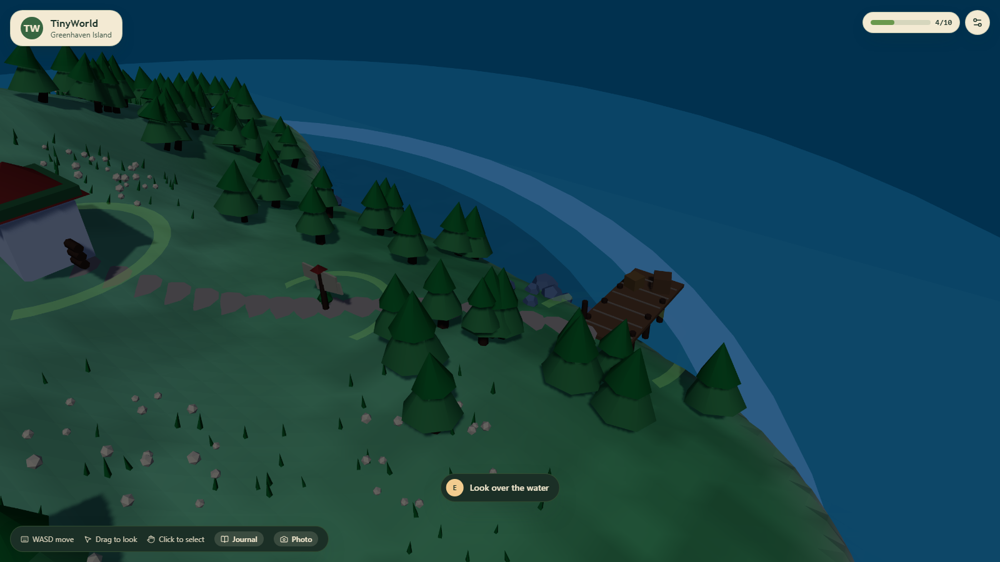
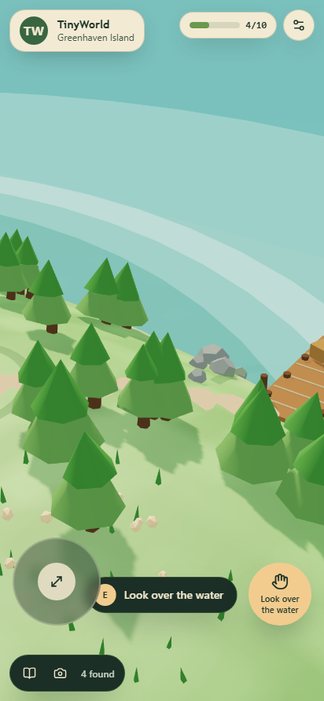

# TinyWorld

[](https://github.com/zann06/TinyWorld/actions/workflows/ci.yml)

**A little world, waiting to be explored.**

TinyWorld is an open-source, browser-based 3D exploration game. Two islands —
Greenhaven and Cairnmoor — each rendered in real time with WebGL 2. Walk the
coast path, read the signpost, light the watchtower lantern, stoke the campfire,
drink from the spring, climb to the arch, then take a photograph of the whole
thing at dusk.



---

## What it is

Two deliberately composed islands rendered in real time with WebGL 2, eighteen
landmarks between them, each with its own story and its own real interaction.
Switch islands from the header at any time; progress is kept separately for each.

| Island           | Landmarks | Character                                                                                     |
| ---------------- | --------- | --------------------------------------------------------------------------------------------- |
| Greenhaven       | 10        | Green, generous, sheltered. A lighthouse, a cottage, a tended garden and a coast path.          |
| Cairnmoor Isle   | 8         | Smaller, higher, colder and rockier. A beached wreck, a stone cairn and a boathouse.           |

## Screenshots

| Exploration                                                      | Dusk                                                    |
| ---------------------------------------------------------------- | ------------------------------------------------------- |
|  |  |

| Night                                                     | Mobile                                                          |
| --------------------------------------------------------- | --------------------------------------------------------------- |
|  |  |

## Features

- **Two real 3D islands** — rolling terrain, an irregular coastline with a sheltered
  bay, beaches, a footpath, forests, rocks and flowers. Everything is generated
  procedurally, so there are no missing assets and no download step. Each island
  has its own height field, palette, scatter seed and landmark set.
- **Eighteen landmarks** across the two islands, each with a name, category,
  description and a distinct interaction that changes the world or reveals a story.
- **An island switcher** in the header. Travel is instant and per-island progress
  is stored separately, so clearing one island never touches the other.
- **Discovery progress** that persists locally. 4 of 10, 10 of 10 — progress is
  tracked, deduplicated and survives a refresh.
- **Hybrid controls** — WASD or arrows to walk, drag to look, wheel to zoom,
  click to select, `E` to interact. On touch devices, an analog joystick and a
  large action button appear automatically.
- **A full DOM interface** — a searchable island directory listing every
  landmark as real HTML, with selection and actions that do not require touching
  the 3D view at all.
- **A day/night cycle** with day, dusk and night lighting presets, plus an
  optional slow automatic cycle.
- **Photo mode** — hide the interface, frame the shot, export the live renderer
  output as a PNG.
- **Quality settings** (Low / Medium / High) that change pixel ratio, shadows
  and decoration density live.
- **Synthesised ambient audio** — surf, wind and the occasional bird, generated
  with the Web Audio API. No audio files, no licensing questions.
- **Persistence you can trust** — every stored value is validated on read, and a
  blocked or corrupt `localStorage` degrades to an in-memory session instead of
  crashing.
- **Accessibility** — full keyboard navigation, managed dialog focus, visible
  focus rings, AA contrast, and `prefers-reduced-motion` honoured on first run.

## Technology

|                                       |                                    |
| ------------------------------------- | ---------------------------------- |
| React 19 + TypeScript 5               | UI and component architecture      |
| Vite                                  | Dev server and production build    |
| Three.js + React Three Fiber 9         | WebGL 2 rendering                  |
| Tailwind CSS 4                        | Styling and responsive layout      |
| Motion                                | UI animation                       |
| Zustand                               | Shared application state           |
| lucide-react                          | Icons                              |
| Vitest + Testing Library              | Unit and component tests           |
| Playwright + axe-core                 | End-to-end and accessibility tests |
| Web Audio API                         | Synthesised ambient sound          |

Rendering is **WebGL 2**. WebGPU is deliberately not used: it would add
compatibility risk without improving the experience for this scope.

### Loading

Nothing in `src/` outside `src/world/` imports Three.js or React Three Fiber,
which is what makes the split possible. `src/app/App.tsx` loads `WorldCanvas`
through `React.lazy`, so the build emits two chunks:

| Chunk          | Gzipped  | Contains                                          |
| -------------- | -------- | ------------------------------------------------- |
| `index`        | ~133 kB  | App shell, stores, dialogs, directory, audio      |
| `WorldCanvas`  | ~259 kB  | Three.js, React Three Fiber, terrain, scene, props |

Until the second chunk resolves, the shell renders the island directory, the
journal and the onboarding guide, which are fully usable without WebGL. The
loading state during that window is identical to the one shown while the scene
builds its geometry, so the handover does not flash. If the chunk fails to
load, the existing error boundary catches it.

Traveling between islands remounts the scene (keyed on the island id), which is
what regenerates the terrain mesh and the instanced vegetation rather than
leaving the previous island's geometry in place.

## Prerequisites

- **Node.js 22.12 or newer** (22 or 24 LTS recommended)
- npm 10 or newer
- A browser with WebGL 2: Chrome/Edge 56+, Firefox 51+, Safari 15+

## Installation

```bash
git clone https://github.com/zann06/TinyWorld.git
cd tinyworld
npm ci
```

`npm ci` installs exactly what `package-lock.json` pins, which is the
reproducible path.

## Development

```bash
npm run dev      # http://localhost:5173
```

## Commands

| Command                 | Description                                      |
| ----------------------- | ------------------------------------------------ |
| `npm run dev`           | Vite dev server                                  |
| `npm run build`         | Type-check and build for production into `dist/` |
| `npm run preview`       | Serve the production build locally               |
| `npm run lint`          | ESLint                                           |
| `npm run lint:fix`      | ESLint with autofix                              |
| `npm run typecheck`     | TypeScript, no emit                              |
| `npm test`              | Vitest unit and component tests                  |
| `npm run test:watch`    | Vitest in watch mode                             |
| `npm run test:coverage` | Vitest with a V8 coverage report                 |
| `npm run test:e2e` | Playwright end-to-end tests |
| `npm run screenshots` | Re-capture the README screenshots (needs `npm run preview` running) |
| `npm run format` | Prettier write |
| `npm run format:check` | Prettier check (used by CI) |
| `npm run verify` | format check + lint + typecheck + unit tests + build |

Playwright needs a browser once: `npx playwright install chromium`.

## Controls

Full details in [`docs/CONTROLS.md`](docs/CONTROLS.md).

**Desktop** — `W` `A` `S` `D` or arrows to walk · drag to look · wheel to zoom ·
click to select · `E` to interact · `Esc` to close · `F` for photo mode ·
`J` for the journal.

**Touch** — analog stick to walk · drag to look · tap to select · the large
action button to interact. Controls appear automatically on coarse-pointer
devices.

**Switching islands?** The header carries an island switcher showing each island's
discovery count. Travel is instant and progress is stored per island.

**No mouse, no keyboard?** The island directory lists every landmark as
readable HTML with search, filtering and working actions. A skip link at the
top of the page jumps straight to it.

## Project layout

```
src/
  app/         App shell, providers
  components/  UI primitives, layout, feedback
  features/    exploration, discoveries, settings, photo mode, onboarding
  world/       canvas, scene, terrain, objects, characters, camera, lighting
  game/        input, collision, interaction, discovery
  store/       Zustand stores and persistence
  data/        island definitions, per-island landmarks, coastline maths
    islands/   one landmark list per island
  lib/         storage, audio, webgl detection, renderer bridge
  types/       shared domain types
tests/
  unit/        pure logic
  components/  React behaviour and accessibility contracts
  e2e/         full journeys, responsive layout, axe-core audits
docs/          architecture, controls, contribution guide, screenshots
scripts/       screenshot and release-image capture helpers
```

See [`docs/ARCHITECTURE.md`](docs/ARCHITECTURE.md) for the reasoning behind the
structure, and [`docs/CONTRIBUTING.md`](docs/CONTRIBUTING.md) to contribute.

## Adding a 3D object

TinyWorld is data-driven. Adding a landmark touches exactly two files.

**1. Declare it** in the island's landmark list — `src/data/islands/greenhaven-objects.ts`
or `src/data/islands/cairnmoor-objects.ts`:

```ts
{
  id: 'lighthouse',                    // stable, never renamed, unique across islands
  name: 'Northwind Lighthouse',
  category: 'landmark',
  summary: 'A striped tower that has guided sailors for a century.',
  description: '…shown once discovered…',
  position: { x: 30, y: 0, z: -18 },  // y is derived from the terrain
  radius: 4,
  discoverable: true,
  interactable: true,
  actionLabel: 'Climb the spiral stair',
  visual: 'lighthouse',
}
```

**2. Build it** as a component in `src/world/objects/ObjectVisual.tsx`, with its
base at `y = 0`, and register it in
`src/world/objects/visual-registry.ts`.

If it should block movement, add a radius to that island's `obstacles` in
`src/data/islands.ts`.

That is all. The scene, the journal, the island directory, the interaction
prompt, the progress counter and local persistence pick it up automatically.
Three unit tests guard the edges: a declared object without a registered visual
fails, a landmark placed below the waterline fails, and an object id claimed by
two islands fails.

To add a **whole new island**, add one entry to `ISLANDS` in
`src/data/islands.ts` — coastline, height field, palette, footpath, obstacles,
scatter and landmarks. Nothing outside that file branches on which island is
active.

## Testing

```bash
npm test          # 239 unit and component tests
npm run test:e2e  # 38 end-to-end tests across desktop and mobile viewports
```

The end-to-end suite launches a real browser, verifies the scene actually
renders (it samples canvas pixels rather than trusting that the element exists),
walks the explorer with the keyboard, performs discoveries, reloads to confirm
persistence, resets progress behind a confirmation dialog, exports a PNG, and
runs axe-core against the world view, the settings dialog and the journal.

`npm run verify` runs lint, type-check, unit tests and a production build.

## Deployment

TinyWorld is a static site. No server, no backend, no environment variables.

### Vercel

Import the repository and accept the defaults. Vite is detected automatically.

```bash
# or, from the command line
npx vercel deploy --prod
```

No environment variables are required. The base path is `/`.

### GitHub Pages

Build with the base path set to the repository sub-path:

```bash
npm ci
VITE_BASE_PATH=/TinyWorld/ npm run build
```

Then publish `dist/` — either with the `gh-pages` branch flow, or with a
GitHub Actions workflow:

```yaml
name: Deploy to GitHub Pages
on:
  push:
    branches: [main]
permissions:
  contents: read
  pages: write
  id-token: write
concurrency:
  group: pages
  cancel-in-progress: true
jobs:
  deploy:
    runs-on: ubuntu-latest
    environment:
      name: github-pages
      url: ${{ steps.deployment.outputs.page_url }}
    steps:
      - uses: actions/checkout@v4
      - uses: actions/setup-node@v4
        with:
          node-version: 22
      - run: npm ci
      - run: npm run build
        env:
          VITE_BASE_PATH: /${{ github.event.repository.name }}/
      - uses: actions/configure-pages@v5
      - uses: actions/upload-pages-artifact@v3
        with:
          path: dist
      - id: deployment
        uses: actions/deploy-pages@v4
```

After deploying, check the public URL directly. Asset paths and routing must be
verified from the deployed origin, not from `localhost`.

### Any static host

`npm run build` produces a self-contained `dist/` directory. Serve it with any
static file server.

## Known limitations

- **Procedural art only.** Every model is built from primitives. TinyWorld ships
  no third-party models or textures (see [`ASSET_CREDITS.md`](ASSET_CREDITS.md)).
- **No external asset loading**, so there are no loading spinners for models and
  no cross-origin asset issues when exporting screenshots.
- **Three.js is the heaviest dependency.** The islands ship as their own lazy
  chunk (~259 kB gzipped), so the interface - top bar, island directory,
  journal, settings and the onboarding guide - paints from a ~133 kB gzipped
  shell while the renderer is still streaming in. Splitting Three.js out of that
  chunk would help further.
- **Switching islands rebuilds the whole scene.** The terrain mesh and every
  instanced prop are regenerated, which takes a beat under software rendering.
  Terrain is not cached between visits.
- **Audio starts after a user gesture**, as browser autoplay policy requires.
  Nothing is audible until the first click, key press or tap.
- **Position is saved every four seconds.** Reloading within that window returns
  you to where you left off, which is not always the exact last step.
- **Headless browser testing is slow.** CI renders WebGL with SwiftShader on the
  CPU, so the end-to-end suite runs serially. Tests pin the lowest quality preset
  so the software renderer spends its budget on behaviour rather than shadows.

## Contributing

Issues and pull requests are welcome. Read
[`docs/CONTRIBUTING.md`](docs/CONTRIBUTING.md) first — it covers the house
rules, and the checks CI will run.

## Licence

Source code is released under the [MIT Licence](LICENSE).

TinyWorld bundles no third-party art assets. See
[`ASSET_CREDITS.md`](ASSET_CREDITS.md) for the full attribution record.
