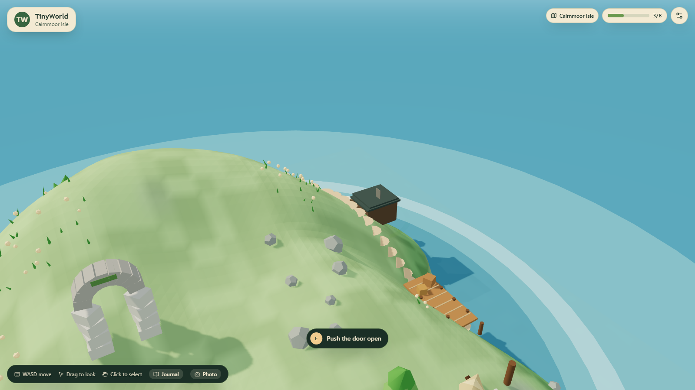
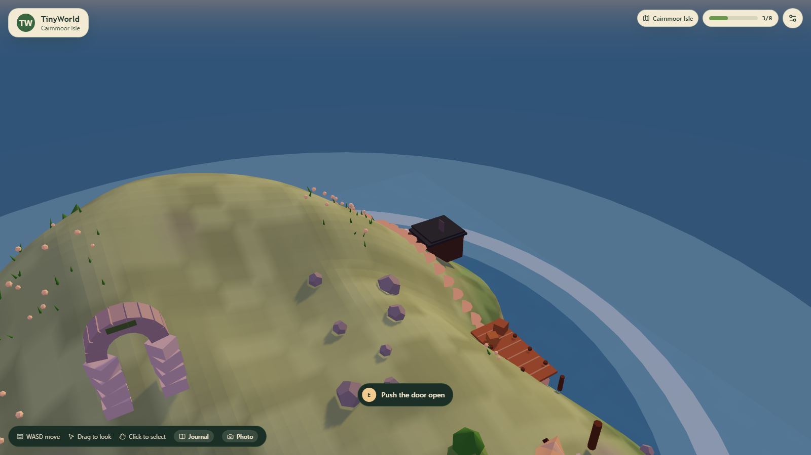

# TinyWorld

[](https://github.com/zann06/TinyWorld/actions/workflows/ci.yml)
[](https://github.com/zann06/TinyWorld/actions/workflows/deploy.yml)

**A little world, waiting to be explored.**

**Play online:** <https://zann06.github.io/TinyWorld/>

TinyWorld is an open-source, browser-based 3D exploration game. Three islands —
Greenhaven, Cairnmoor and Hearthfall — each rendered in real time with WebGL 2.
Walk the coast path, read the signpost, light the watchtower lantern, stoke the
campfire, follow the Legacy trail across all three islands, then take a
photograph of the whole thing at dusk.


---

## What it is

Three deliberately composed islands rendered in real time with WebGL 2,
thirty-five things to find between them — twenty-six landmarks, each with its
own story and its own real interaction, plus nine collectible keepsakes hidden
slightly off the path. Switch islands from the header at any time; progress is
kept separately for each, and the Legacy campaign links a trail of discoveries
across all three, tracked by an always-visible objective HUD.

| Island          | Landmarks | Keepsakes | Character                                                                              |
| --------------- | --------- | --------- | -------------------------------------------------------------------------------------- |
| Greenhaven      | 10        | 3         | Green, generous, sheltered. A lighthouse, a cottage, a tended garden and a coast path.  |
| Cairnmoor Isle  | 8         | 3         | Smaller, higher, colder and rockier. A beached wreck, a stone cairn and a boathouse.    |
| Hearthfall Isle | 8         | 3         | Remote and volcanic. A first hearth, a record wall, a tide bell and warm springs.       |

## Screenshots

<table>
  <tr>
    <td></td>
    <td></td>
  </tr>
  <tr>
    <td></td>
    <td></td>
  </tr>
  <tr>
    <td></td>
    <td></td>
  </tr>
</table>

Greenhaven Island — the four images on the top two rows — is the warm, sheltered
one, with its lighthouse, cottage, garden and coast path. Cairnmoor Isle, on the
bottom row, is smaller, higher and rockier: a beached wreck, a stone cairn and a
boathouse among standing stones. Hearthfall Isle continues the journey with a
first hearth, a record wall and a tide bell.

## Features

- **Three real 3D islands** — rolling terrain, an irregular coastline with a sheltered
  bay, beaches, a footpath, forests, rocks and flowers. Everything is generated
  procedurally, so there are no missing assets and no download step. Each island
  has its own height field, palette, scatter seed and landmark set.
- **Twenty-six landmarks** across the three islands, each with a name, category,
  description and a distinct interaction that changes the world or reveals a story.
- **Nine collectible keepsakes** — three shells, shards and totems per island,
  tucked off the path, each with its own micro-story from the islands' history.
- **An island switcher** in the header. A soft fade covers each trip, visited
  islands stay mounted, and per-island progress is stored separately, so clearing
  one island never touches the others.
- **The Legacy campaign** — a five-step trail that begins on Greenhaven, continues
  on Cairnmoor and finishes on Hearthfall. Progress is derived from discoveries,
  so it can never disagree with the per-island counters.
- **A story that reads itself** — the tale of the Nine, the first settlers, told in
  ten journal fragments that unlock as you follow their route: a prologue, one entry
  per Legacy step, three keepsake milestones, and an epilogue moment when the trail
  is finished. Like the quest state, the story is derived from discoveries — there
  is no second save file to drift out of sync.
- **An objective HUD that keeps the quest readable** — an always-visible quest
  tracker naming the current step, a compass pointing at the target with the live
  distance, and a golden in-world beacon over the landmark that completes the step.
- **Discovery progress** that persists locally. 4 of 13, 13 of 13 — progress is
  tracked, deduplicated and survives a refresh.
- **Hybrid controls** — WASD or arrows to walk, hold `Shift` (or push the touch
  stick to its edge) to sprint, drag to look, wheel to zoom, click to select,
  `E` to interact. On touch devices, an analog joystick and a large action button
  appear automatically.
- **A full DOM interface** — a searchable island directory listing every
  landmark as real HTML, with selection and actions that do not require touching
  the 3D view at all.
- **A day/night cycle** with day, dusk and night lighting presets, plus an
  optional slow automatic cycle.
- **Photo mode** — hide the interface, frame the shot, export the live renderer
  output as a PNG.
- **Quality settings** (Low / Medium / High) that change pixel ratio, shadows,
  decoration density and terrain tessellation live.
- **Synthesised ambient audio** — surf, wind and the occasional bird, generated
  with the Web Audio API. No audio files, no licensing questions.
- **Persistence you can trust** — every stored value is validated on read, and a
  blocked or corrupt `localStorage` degrades to an in-memory session instead of
  crashing.
- **Accessibility** — full keyboard navigation, managed dialog focus, visible
  focus rings, AA contrast, and `prefers-reduced-motion` honoured on first run.

## Technology

|                                       |                                    |
| ------------------------------------- | ---------------------------------- |
| React 19 + TypeScript 5               | UI and component architecture      |
| Vite                                  | Dev server and production build    |
| Three.js + React Three Fiber 9         | WebGL 2 rendering                  |
| Tailwind CSS 4                        | Styling and responsive layout      |
| Motion                                | UI animation                       |
| Zustand                               | Shared application state           |
| lucide-react                          | Icons                              |
| Vitest + Testing Library              | Unit and component tests           |
| Playwright + axe-core                 | End-to-end and accessibility tests |
| Web Audio API                         | Synthesised ambient sound          |

Rendering is **WebGL 2**. WebGPU is deliberately not used: it would add
compatibility risk without improving the experience for this scope.

### Loading

Nothing in `src/` outside `src/world/` imports Three.js or React Three Fiber,
which is what makes the split possible. `src/app/App.tsx` loads `WorldCanvas`
through `React.lazy`, and the renderer stack is assigned to its own chunk:

| Chunk         | Gzipped | Contains                                               |
| ------------- | ------- | ------------------------------------------------------ |
| `index`       | ~132 kB | App shell, stores, dialogs, directory, audio           |
| `WorldCanvas` | ~72 kB  | Island scene, terrain, objects, camera, lighting, R3F  |
| `three`       | ~181 kB | Three.js                                               |

Keeping Three.js in a separate chunk means a deployment that only changes game
code does not invalidate the largest cached asset. Both `WorldCanvas` and
`three` are fetched after the shell has painted; neither is preloaded with the
entry HTML.

Until the renderer resolves, the shell renders the island directory, the journal
and the onboarding guide, which are fully usable without WebGL. The loading
state during that window is identical to the one shown while the scene builds
its geometry, so the handover does not flash. If a chunk fails to load, the
existing error boundary catches it.

Visited islands stay mounted; travel toggles which environment is visible rather
than remounting the scene. Terrain geometry and scatter transforms are cached per
island, and idle time after the first scene settles is used to build the other
islands ahead of time, so a trip reuses geometry that already exists. Lighting,
the shared sky, the player and the camera switch to the active island.

## Prerequisites

- **Node.js 22.12 or newer** (22 or 24 LTS recommended)
- npm 10 or newer
- A browser with WebGL 2: Chrome/Edge 56+, Firefox 51+, Safari 15+

## Installation

```bash
git clone https://github.com/zann06/TinyWorld.git
cd tinyworld
npm ci
```

`npm ci` installs exactly what `package-lock.json` pins, which is the
reproducible path.

## Development

```bash
npm run dev      # http://localhost:5173
```

## Commands

| Command                 | Description                                      |
| ----------------------- | ------------------------------------------------ |
| `npm run dev`           | Vite dev server                                  |
| `npm run build`         | Type-check and build for production into `dist/` |
| `npm run budget`        | Check gzipped bundle sizes against the budget    |
| `npm run preview`       | Serve the production build locally               |
| `npm run lint`          | ESLint                                           |
| `npm run lint:fix`      | ESLint with autofix                              |
| `npm run typecheck`     | TypeScript, no emit                              |
| `npm test`              | Vitest unit and component tests                  |
| `npm run test:watch`    | Vitest in watch mode                             |
| `npm run test:coverage` | Vitest with a V8 coverage report                 |
| `npm run test:e2e` | Playwright end-to-end tests |
| `npm run screenshots` | Re-capture the README screenshots (needs `npm run preview` running) |
| `npm run format` | Prettier write |
| `npm run format:check` | Prettier check (used by CI) |
| `npm run verify` | format check + lint + typecheck + unit tests + build + budget |

Playwright needs a browser once: `npx playwright install chromium`.

## Controls

Full details in [`docs/CONTROLS.md`](docs/CONTROLS.md).

**Desktop** — `W` `A` `S` `D` or arrows to walk · drag to look · wheel to zoom ·
click to select · `E` to interact · `Esc` to close · `F` for photo mode ·
`J` for the journal.

**Touch** — analog stick to walk · drag to look · tap to select · the large
action button to interact. Controls appear automatically on coarse-pointer
devices.

**Switching islands?** The header carries an island switcher showing each island's
discovery count. Travel is instant and progress is stored per island.

**No mouse, no keyboard?** The island directory lists every landmark as
readable HTML with search, filtering and working actions. A skip link at the
top of the page jumps straight to it.

## Project layout

```
src/
  app/         App shell, providers
  components/  UI primitives, layout, feedback
  features/    exploration, discoveries, quests, settings, photo mode, onboarding
  world/       canvas, scene, terrain, objects, characters, camera, lighting
  game/        input, collision, interaction, discovery, quest logic
  store/       Zustand stores and persistence
  data/        island definitions, per-island landmarks, quest definitions, coastline maths
    islands/   one landmark list per island
  lib/         storage, audio, webgl detection, renderer bridge
  types/       shared domain types
tests/
  unit/        pure logic
  components/  React behaviour and accessibility contracts
  e2e/         full journeys, responsive layout, axe-core audits
docs/          architecture, controls, contribution guide, screenshots
scripts/       screenshot capture and bundle-budget checks
```

See [`docs/ARCHITECTURE.md`](docs/ARCHITECTURE.md) for the reasoning behind the
structure, and [`docs/CONTRIBUTING.md`](docs/CONTRIBUTING.md) to contribute.

## Adding a 3D object

TinyWorld is data-driven. Adding a landmark touches exactly two files.

**1. Declare it** in the island's landmark list — `src/data/islands/greenhaven-objects.ts`,
`src/data/islands/cairnmoor-objects.ts` or `src/data/islands/hearthfall-objects.ts`:

```ts
{
  id: 'lighthouse',                    // stable, never renamed, unique across islands
  name: 'Northwind Lighthouse',
  category: 'landmark',
  summary: 'A striped tower that has guided sailors for a century.',
  description: '…shown once discovered…',
  position: { x: 30, y: 0, z: -18 },  // y is derived from the terrain
  radius: 4,
  discoverable: true,
  interactable: true,
  actionLabel: 'Climb the spiral stair',
  visual: 'lighthouse',
}
```

**2. Build it** as a component in `src/world/objects/ObjectVisual.tsx`, with its
base at `y = 0`, and register it in
`src/world/objects/visual-registry.ts`.

If it should block movement, add a radius to that island's `obstacles` in
`src/data/islands.ts`.

That is all. The scene, the journal, the island directory, the interaction
prompt, the progress counter and local persistence pick it up automatically.
Three unit tests guard the edges: a declared object without a registered visual
fails, a landmark placed below the waterline fails, and an object id claimed by
two entries fails.

To add a **whole new island**, add one entry to `ISLANDS` in
`src/data/islands.ts` — coastline, height field, palette, footpath, obstacles,
scatter and landmarks. Nothing outside that file branches on which island is
active. A new island also needs a landmark list under `src/data/islands/` and an
entry in the scatter palette; the data-integrity tests will point out anything
missing.

To add a **Legacy step**, append to `LEGACY_QUEST.steps` in `src/data/quests.ts`.
Steps are matched by island id and landmark id in order, so an earlier
discovery cannot skip ahead.

## Testing

```bash
npm test          # 289 unit and component tests
npm run test:e2e  # 42 end-to-end cases; 3 viewport-specific skips, 39 pass
```

The end-to-end suite launches a real browser, verifies the scene actually
renders (it samples canvas pixels rather than trusting that the element exists),
walks the explorer with the keyboard, performs discoveries, reloads to confirm
persistence, resets progress behind a confirmation dialog, travels back and forth
across all three islands, follows the Legacy campaign, exports a PNG, and runs
axe-core against the world view, the settings dialog and the journal.

`npm run verify` runs the format check, lint, type-check, unit tests, a
production build and the bundle budget.

## Deployment

TinyWorld is a static site. No server, no backend, no environment variables.

### Vercel

Import the repository and accept the defaults. Vite is detected automatically.

```bash
# or, from the command line
npx vercel deploy --prod
```

No environment variables are required. The base path is `/`.

### GitHub Pages

The repository ships [`.github/workflows/deploy.yml`](.github/workflows/deploy.yml).
On every push to `main` — and on manual dispatch — it installs from the
lockfile, builds with `VITE_BASE_PATH=/<repository>/`, uploads `dist/` as a
Pages artifact and deploys it.

Pages must be enabled once under **Settings → Pages → Build and deployment →
Source → GitHub Actions**. The site is then published at
<https://zann06.github.io/TinyWorld/>.

To reproduce the Pages build locally:

```bash
npm ci
VITE_BASE_PATH=/TinyWorld/ npm run build
npm run preview
```

After deploying, check the public URL directly. Asset paths and routing must be
verified from the deployed origin, not from `localhost`.

### Any static host

`npm run build` produces a self-contained `dist/` directory. Serve it with any
static file server.

## Known limitations

- **Procedural art only.** Every model is built from primitives. TinyWorld ships
  no third-party models or textures (see [`ASSET_CREDITS.md`](ASSET_CREDITS.md)).
- **No external asset loading**, so there are no loading spinners for models and
  no cross-origin asset issues when exporting screenshots.
- **Three.js is the heaviest dependency.** It ships in its own lazy `three`
  chunk (~181 kB gzipped), separate from the ~72 kB scene chunk and the ~132 kB
  interface shell, so it is cached independently of game-code changes.
- **Visited islands stay in GPU memory.** Keeping each island mounted is what
  makes return trips instant, but it trades memory for speed. The bundle and
  asset-size budget in `npm run budget` guards the download side, not GPU
  residency.
- **Audio starts after a user gesture**, as browser autoplay policy requires.
  Nothing is audible until the first click, key press or tap.
- **Position is saved every four seconds.** Reloading within that window returns
  you to where you left off, which is not always the exact last step.
- **Headless browser testing is slow.** CI renders WebGL with SwiftShader on the
  CPU, so the end-to-end suite runs serially. Tests pin the lowest quality preset
  so the software renderer spends its budget on behaviour rather than shadows.

## Contributing

Issues and pull requests are welcome. Read
[`docs/CONTRIBUTING.md`](docs/CONTRIBUTING.md) first — it covers the house
rules, and the checks CI will run.

## Licence

Source code is released under the [MIT Licence](LICENSE).

TinyWorld bundles no third-party art assets. See
[`ASSET_CREDITS.md`](ASSET_CREDITS.md) for the full attribution record.
